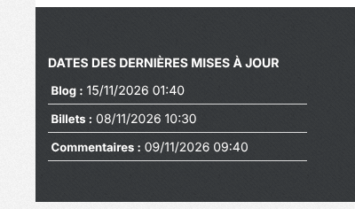
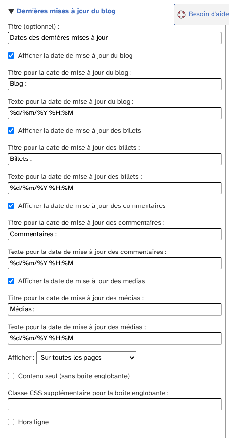
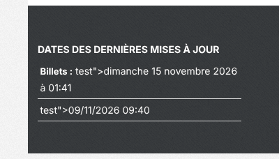

# lastBlogUpdate : guide d'utilisation

lastBlogUpdate affiche aux visiteurs, dans un gadget, la date de la dernière mise à jour du blog, des billets, des commentaires et des médias.

## Table des matières

1. [Ajouter le gadget](#ajouter-le-gadget)
2. [Les réglages](#les-réglages)
3. [Personnaliser l'affichage](#personnaliser-laffichage)
4. [Bon à savoir](#bon-à-savoir)

## Ajouter le gadget

Allez dans **Gadgets**, puis ajoutez « Dernières mises à jour du blog » à la zone de votre choix (par exemple « Extra »). Enregistrez.

Sur le blog, le gadget affiche une ligne par information.

Chaque date de billet et de commentaire est un lien vers l'élément concerné. Le titre du billet apparaît au survol.

## Les réglages

Cliquez sur le nom du gadget pour déplier ses réglages.

* **Titre** : le titre du gadget. Laissez-le vide pour ne pas en afficher.
* Pour chacune des quatre lignes (blog, billets, commentaires, médias) :
  * la case « Afficher… » active ou masque la ligne ;
  * « Titre pour… » est le libellé affiché avant la date (vide : pas de libellé) ;
  * « Texte pour… » est le format de la date.
* Les options habituelles des gadgets : page d'accueil uniquement, contenu seul, classe CSS, hors ligne.

## Personnaliser l'affichage

Le format de la date utilise les codes de la date PHP : `%d/%m/%Y %H:%M` donne « 15/11/2026 01:40 », `%A %e %B %Y à %H:%M` donne « dimanche 15 novembre 2026 à 01:41 ». Une ligne dont le format est vide n'est pas affichée.

Dans cet exemple, la ligne du blog est masquée, le format des billets est changé et le libellé des commentaires est vidé.

Le gadget ne s'affiche pas du tout s'il n'y a rien à montrer : par exemple si toutes les lignes sont désactivées, ou si le blog n'a encore ni billet, ni commentaire, ni média.

## Bon à savoir

* La ligne « Médias » n'apparaît que si le dossier public du blog contient des médias connus de la médiathèque.
* La date de mise à jour du blog est celle de la dernière modification enregistrée par Dotclear (nouvelle publication, commentaire, etc.), pas la date de dernière visite.
* Le titre du billet utilisé dans l'infobulle du lien n'est pas protégé : un titre contenant des guillemets (`"`) ou du HTML casse le code de la page à cet endroit.
